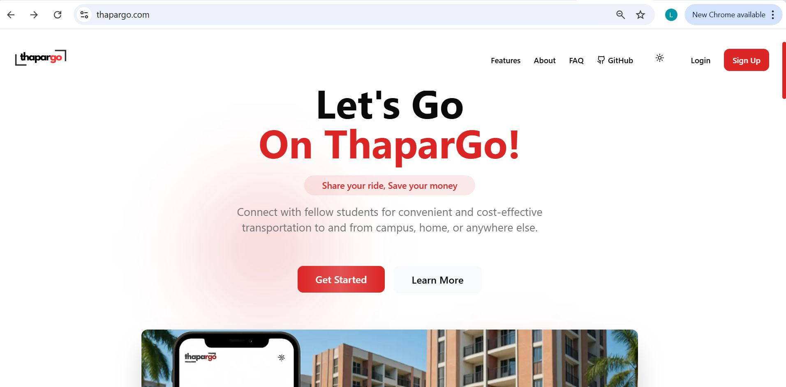
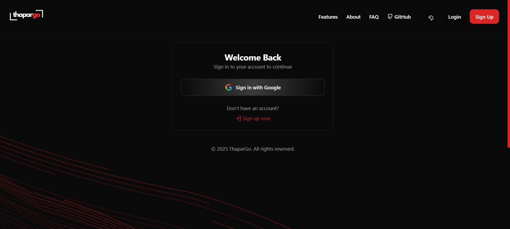
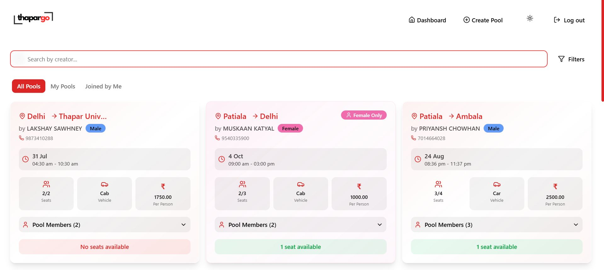
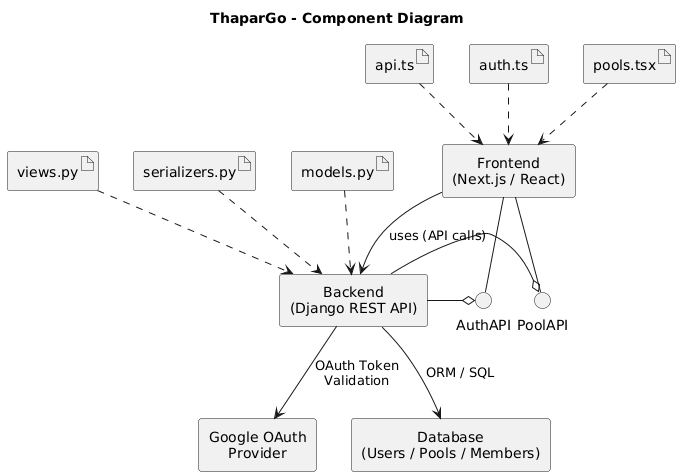
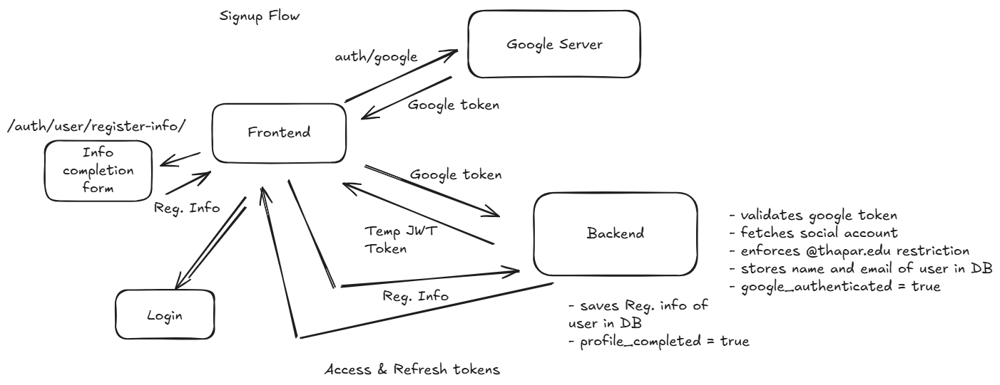
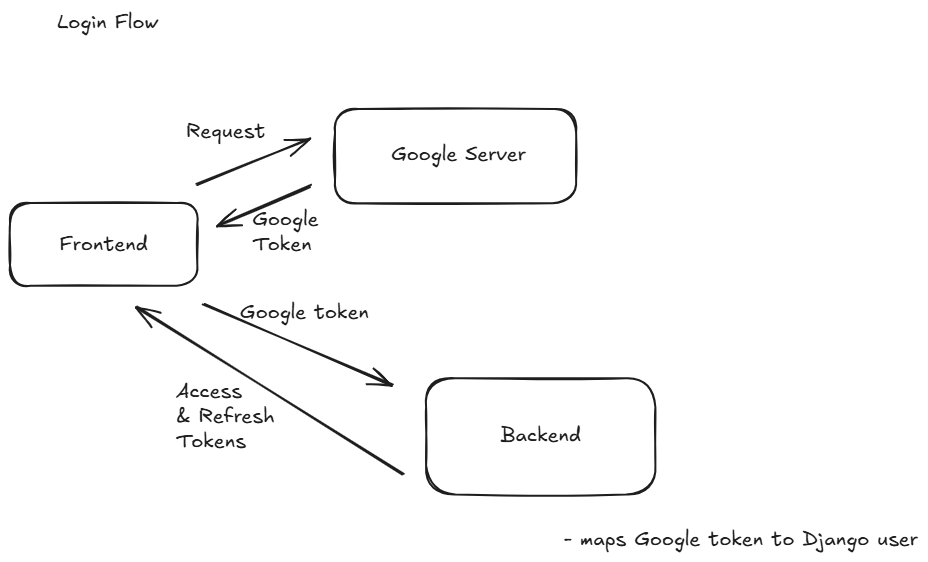
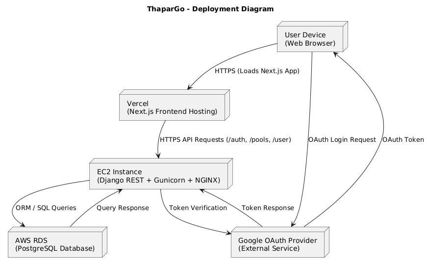
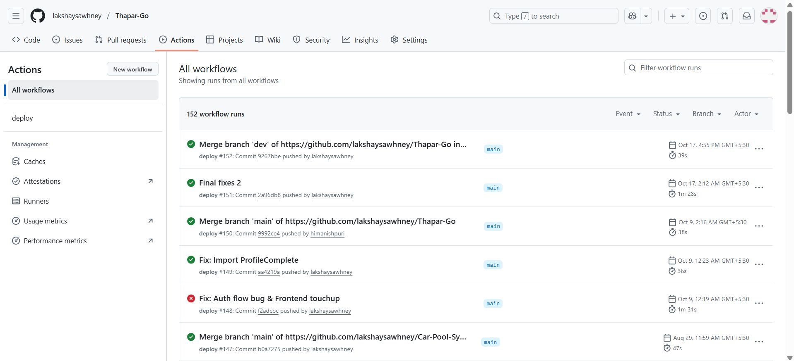

# ThaparGo

A production-grade ride-pooling web platform built exclusively for students of **Thapar Institute of Engineering & Technology**, enabling verified students to create, discover, and join shared rides safely.

**Live Website:** [www.thapargo.com](https://www.thapargo.com)

  

---

## Overview

Students at Thapar often need to share cabs or cars while travelling between campus, home, railway stations, airports, Delhi, Patiala, Ambala, and nearby locations.

Earlier, students usually relied on scattered WhatsApp groups, which made ride coordination messy, limited, unreliable, and difficult to trust.

**ThaparGo** solves this by providing a centralized, verified, university-only ride-pooling platform where students can create and join ride pools with structured ride details, seat availability, fare sharing, and safety-focused options like female-only pools.

---

## Key Highlights

- University-only access restricted to verified `@thapar.edu` accounts
- Google OAuth + JWT based authentication system
- Create, browse, search, filter, and join ride pools
- Female-only ride pools with backend-level access validation
- Pool member tracking and seat availability management
- Production backend deployed on AWS EC2
- Dockerized Django REST backend behind NGINX and Gunicorn
- GitHub Actions based CI/CD pipeline
- Cloudflare DNS and SSL configuration
- Served approximately **2.5K+ monthly users** and **95K+ requests/month**

---

## Tech Stack

| Layer | Technologies |
|---|---|
| Frontend | Next.js, TypeScript, Tailwind CSS |
| Backend | Django, Django REST Framework |
| Auth | Google OAuth, JWT |
| Database | PostgreSQL |
| Deployment | AWS EC2, Docker, Gunicorn, NGINX |
| CI/CD | GitHub Actions |
| DNS / SSL | Cloudflare |

---

## Core Features

### Verified Student Authentication

Only users with a valid Thapar email can access the platform.

- Google OAuth login
- `@thapar.edu` domain restriction
- JWT access and refresh tokens
- Profile completion flow
- Refresh token blacklisting on logout

  

---

### Ride Pool Discovery

Students can browse available pools and quickly find relevant rides.

- View all pools
- View pools created by the user
- View pools joined by the user
- Search by creator
- Filter ride pools
- Check seats, fare, vehicle type, date, and time

  

---

### Pool Creation and Joining

Users can create ride pools with structured details:

- Source and destination
- Date and time
- Vehicle type
- Total seats
- Fare per person
- Pool creator details
- Female-only status

The backend validates seat availability, pool membership, and female-only pool restrictions.

---

## System Architecture

ThaparGo follows a client-server architecture with a Next.js frontend, Django REST API backend, PostgreSQL database, and Google OAuth provider.

  

---

## Authentication Flow

ThaparGo uses Google OAuth for identity verification and JWT for authenticated API access. The backend validates the Google token, enforces the `@thapar.edu` restriction, creates or fetches the user, and returns JWT access and refresh tokens.

For new users, the platform also includes a profile completion step before allowing full access to pool features.

  

### Flow Summary

1. User signs in using Google OAuth.
2. Frontend receives the Google token.
3. Google token is sent to the Django REST backend.
4. Backend validates the token with Google.
5. Backend enforces the `@thapar.edu` email restriction.
6. Backend creates or fetches the user record.
7. If profile information is incomplete, the user completes the registration form.
8. Backend saves profile details and marks the profile as completed.
9. JWT access and refresh tokens are returned to the frontend.
10. User can access protected pool APIs.

  

---

## Deployment Architecture

The backend is deployed on AWS EC2 as a Dockerized Django REST service. NGINX handles reverse proxying, Gunicorn serves the Django application, and Cloudflare manages DNS and SSL.

  

---

## Backend Responsibilities

The backend handles:

- Google OAuth token validation
- Domain-restricted login
- JWT generation and refresh flow
- User profile management
- Ride pool creation
- Pool discovery and filtering
- Pool joining logic
- Seat availability updates
- Female-only pool validation
- Logout and token blacklisting
- Protected REST API access

---

## API Modules

| Module | Responsibility |
|---|---|
| Authentication | Google login, JWT issuing, profile completion, logout |
| Users | Student profile and account data |
| Pools | Pool creation, listing, filtering, joining, and member tracking |
| Admin | User and pool moderation support |

---

## Production Engineering

This project involved real deployment and production debugging.

Key engineering work included:

- Dockerizing the backend
- Deploying Django REST on AWS EC2
- Configuring Gunicorn and NGINX
- Managing production environment variables
- Setting up Cloudflare DNS and SSL
- Creating GitHub Actions CI/CD workflow
- Debugging OAuth redirect and production URL issues
- Fixing live deployment and infrastructure failures

  

---

## Impact

ThaparGo was launched as a real product for the Thapar student community.

- Replaced scattered WhatsApp-based ride coordination with a structured platform
- Improved trust through verified university-only access
- Added safety-focused female-only ride pools
- Enabled students to save money through fare splitting
- Delivered a complete production experience from idea to deployment

  

---

## Screenshots

### Landing Page

  

### Login Page

  

### Dashboard

  

---

## Contributors

| Name | Role |
|---|---|
| Lakshay Sawhney | Backend, Authentication, DevOps, Deployment, System Design |
| Himanish Puri | Frontend, Next.js UI |

---

## Contact

**Lakshay Sawhney**  
LinkedIn: [lakshay-sawhney](https://www.linkedin.com/in/lakshay-sawhney/)  
Live Website: [www.thapargo.com](https://www.thapargo.com)

---

  Built for the Thapar student community ❤️

